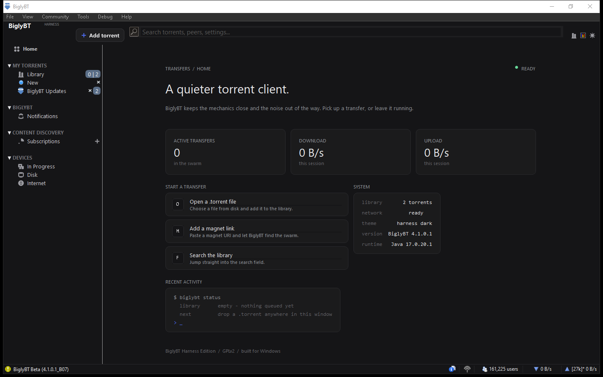
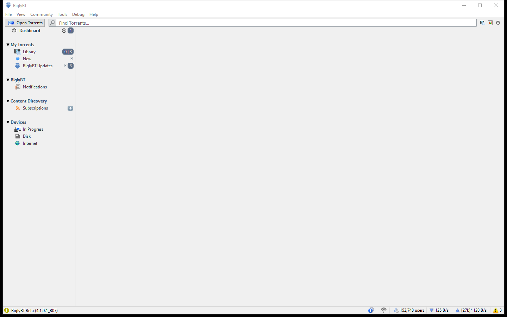
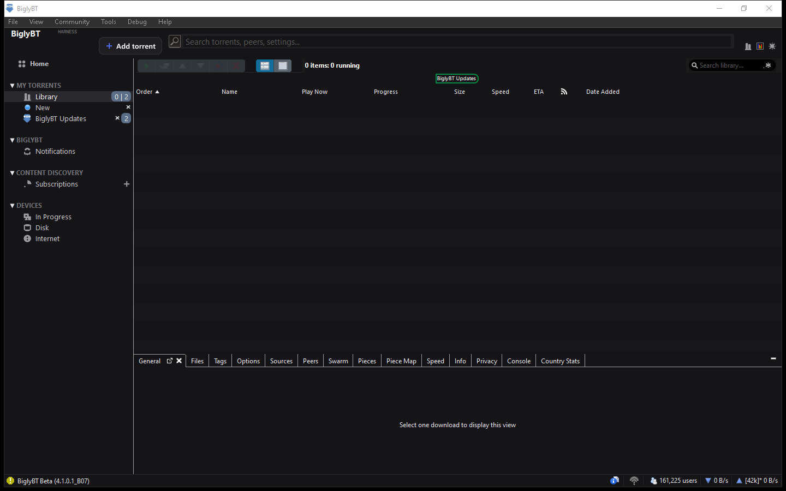

# BiglyBT Harness Edition

A local fork of [BiglySoftware/BiglyBT](https://github.com/BiglySoftware/BiglyBT) with a
dark, quiet Windows UI inspired by the DeepSeek Harness desktop surface.



## The idea

BiglyBT is powerful, but its default Windows surface is a 2000s-era light skin:
small type, a dense menu, a dashboard that embeds a wiki page, and saturated
16px icons. Harness keeps every engine and feature, and replaces the surface
with a focused dark workspace:

- **One canvas, one accent.** Near-black `#151517`, charcoal `#1B1B1C`, hairline
  `#2A2A2D`, and a single cool blue `#4D6BFE`.
- **A real landing surface.** The old wiki browser tile is replaced by a native
  SWT home panel with live transfer numbers, quick actions, a system readout
  and a terminal-style empty state.
- **Quiet chrome.** A taller 56px top bar, a text lockup, a rounded search field,
  a dark primary action, and uppercase sidebar section labels.
- **Monochrome line iconography.** BiglyBT's colourful legacy sidebar icons are
  replaced with a small, consistent 16px set.
- **Dark tables.** Row striping, headers, selections, progress colors and detail
  tabs are all remapped for the dark canvas.

## Design tokens

| Token | Value | Use |
| --- | --- | --- |
| `canvas` | `#151517` | main background |
| `surface` | `#1B1B1C` | sidebar, toolbar, cards |
| `surface raised` | `#1F1F21` | search and action surfaces |
| `hairline` | `#2A2A2D` | borders and dividers |
| `text` | `#E7E7E9` | primary text |
| `muted` | `#8B8F94` | labels and metadata |
| `dim` | `#616166` | tertiary text |
| `accent` | `#4D6BFE` | primary actions and live values |
| `success` | `#67D89A` | ready state |

Type is Segoe UI (10-22pt), with Consolas for numbers and terminal rows. Cards
use 18px rounded corners and 1px hairline borders. Spacing is generous: 52px
content gutters, 20px card padding, 12px card gaps.

## What changed in code

| Area | File(s) |
| --- | --- |
| Dark-first skin overlay and palette | `uis/src/com/biglybt/ui/skin/skin3_harness.properties`, `skin3.properties` |
| Native home surface | `uis/src/com/biglybt/ui/swt/views/skin/HarnessHomePanel.java` |
| Home view + sidebar overlay | `HarnessDashboardView.java`, `MainWindowImpl.java` |
| Dashboard replaces wiki tile | `SB_Dashboard.java`, `skin3_dashboard.properties` |
| Sidebar typography/icons/selection | `SideBar.java`, `SideBarEntrySWT.java` |
| Header, search, add-torrent action | `MainWindowImpl.java`, `skin3_harness.properties` |
| Windows dark system colors and zebra rows | `Colors.java`, `Utils.java`, `SkinPropertiesImpl.java` |
| Window chrome attempt | `Win32UIEnhancer.java` |
| Generated line icons and button art | `uis/src/com/biglybt/ui/images/harness/` |

The build remains upstream-compatible: `mvn -DskipTests package` produces the
same `uis/target/BiglyBT.jar` entry point (`com.biglybt.ui.Main`).

## Build

```powershell
# from the repository root, with a JDK and Maven available
mvn -DskipTests package
```

The build used for the screenshots:

- Temurin JDK 17.0.20.1
- Maven 3.9.9
- SWT 4.9 (`uis/lib/swt-win64.jar`)

## Run

The ready-to-run Windows folder is `dist/BiglyBT-Harness` in the workspace:

```text
run.cmd            # javaw, no console
run-console.cmd    # java, console output
```

Or from the source tree, after building:

```powershell
java --add-opens java.base/java.net=ALL-UNNAMED `
  -cp "uis/target/BiglyBT.jar;uis/lib/swt-win64.jar;core/lib/commons-cli.jar" `
  com.biglybt.ui.Main
```

The working directory should contain the SWT native DLLs and, optionally,
`aereg64.dll`. Without `aereg64.dll`, Windows shell integration is unavailable
but torrenting and the UI work.

## Screenshots

Before, default Windows light skin:



After, Harness home:


After, Library:



## Known limits

- SWT 4.9 still draws a light native title bar and menu bar on this Windows
  host. The app requested Windows' dark app mode and immersive title bar, but
  the legacy SWT/Win32 frame does not honour it consistently. The content area
  is fully dark.
- The Harness home surface is installed as a native SWT overlay on the sidebar
  content host so it renders deterministically on first launch. Switching to
  Library hides it and shows the normal MDI view.
- `aereg64.dll` is not bundled in this repository. It is only needed for
  Explorer/firewall integration.

## License

BiglyBT is GPLv2. This fork keeps the upstream license and copyright notices.
Upstream: <https://github.com/BiglySoftware/BiglyBT>
